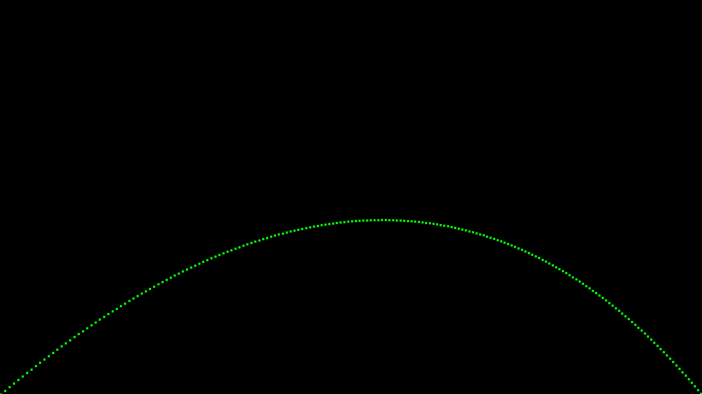
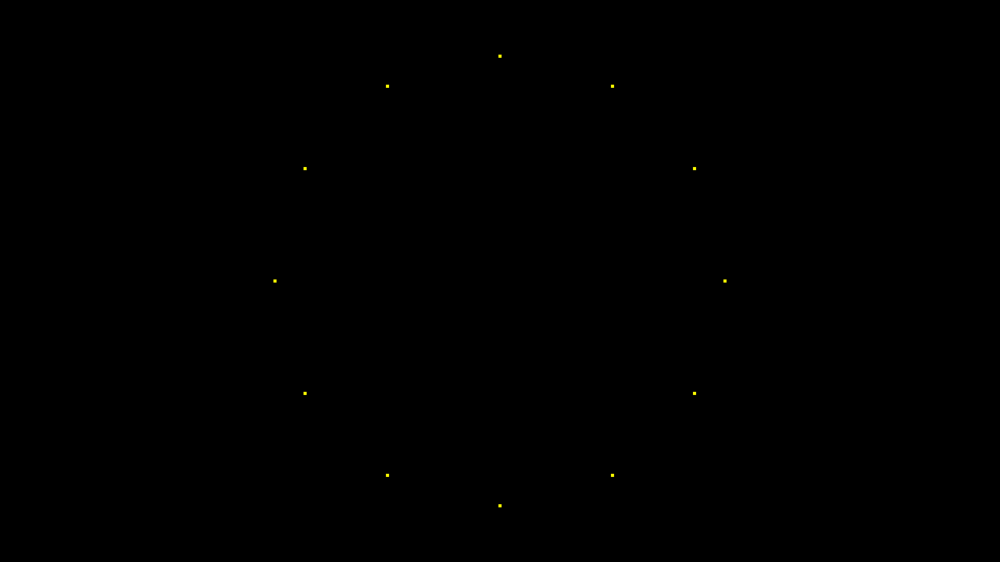
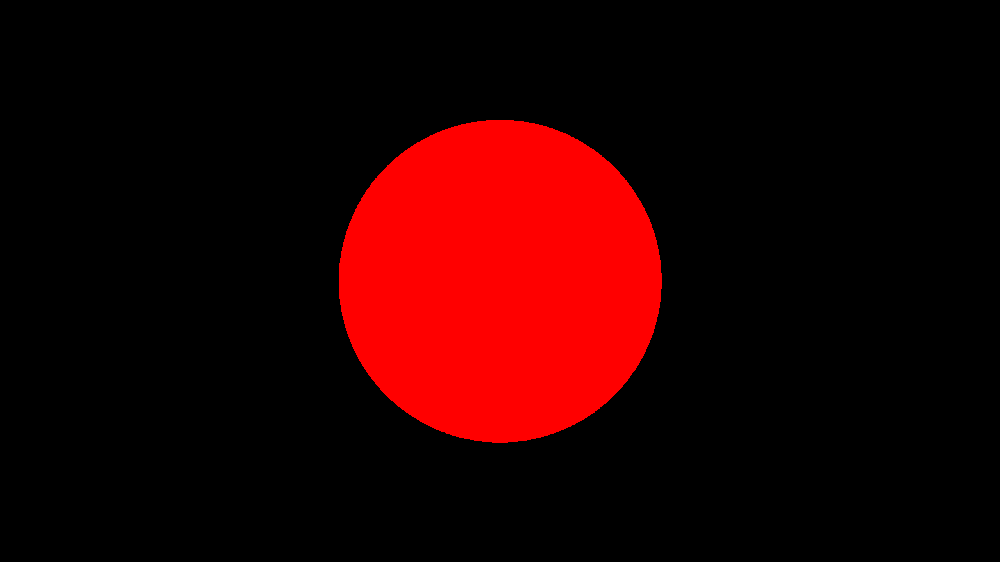
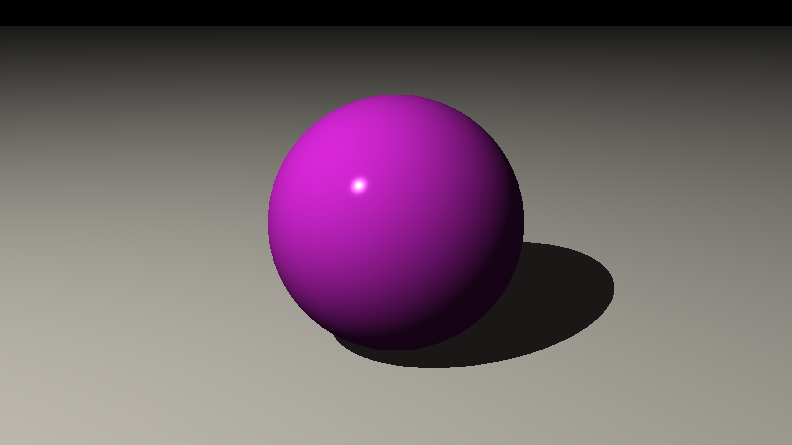
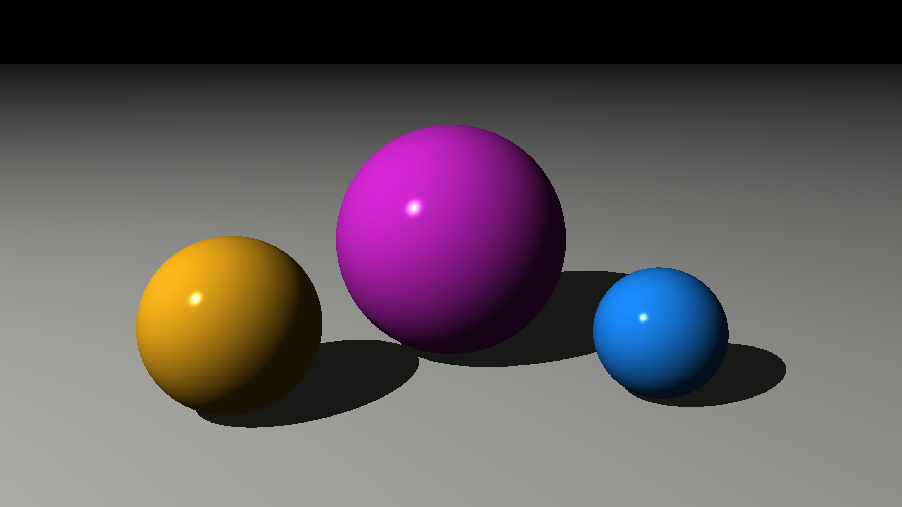
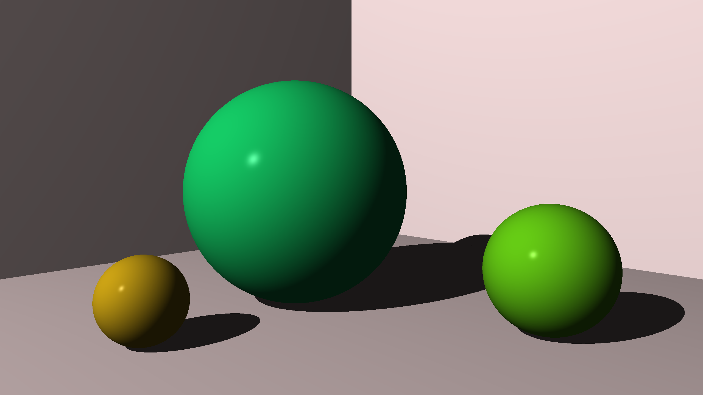
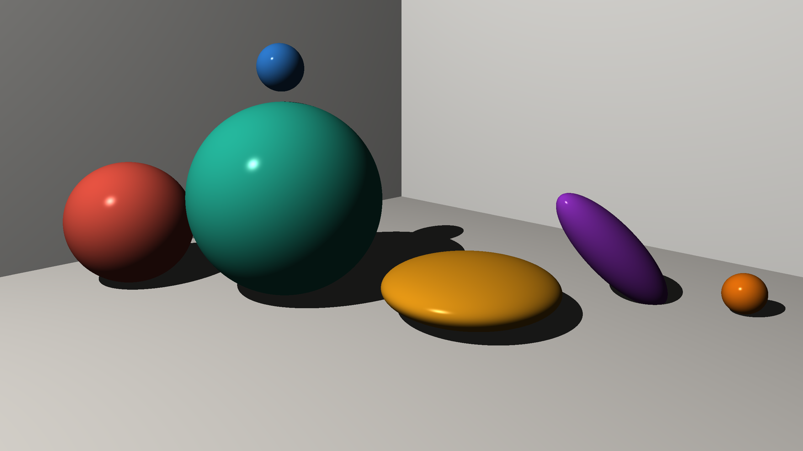
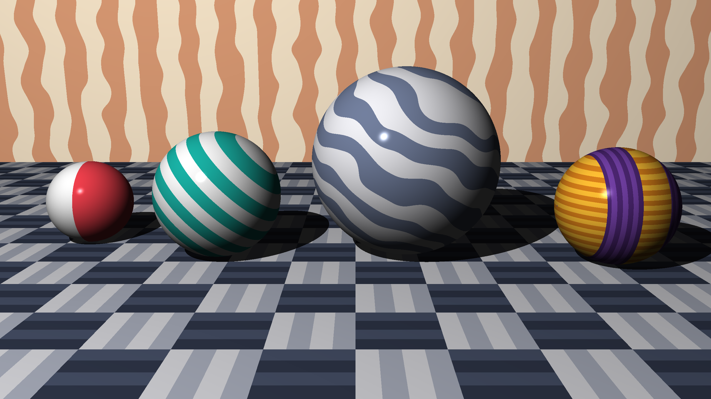
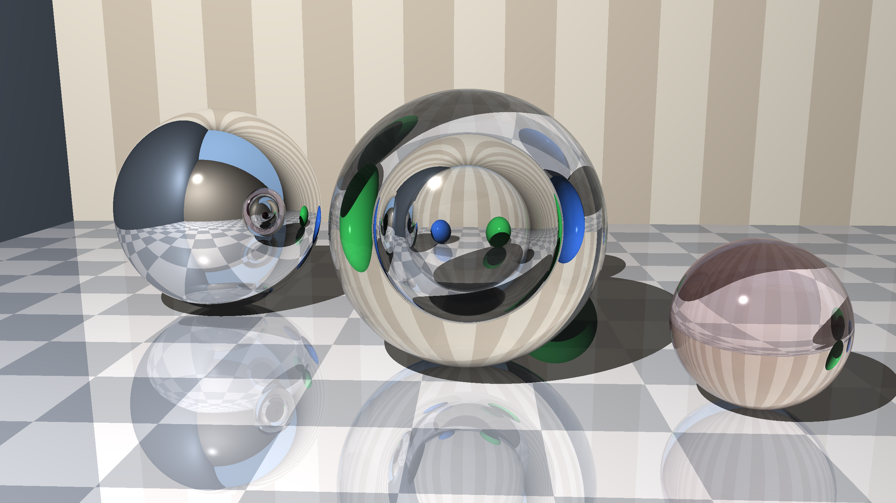
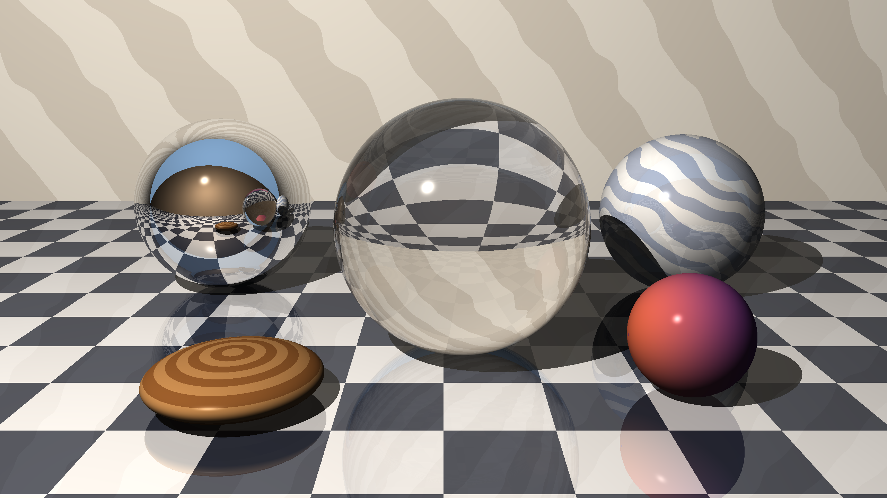

# Renders

This folder contains QHD (2560 × 1440) renders produced by the visualizer programs in [`visualizers/`](../visualizers/). Each image has the same name as the visualizer that renders it.  
Each image is a self-contained demonstration of a specific feature of the ray tracer.

---

## 01 · Project Trajectory

A projectile is launched at an angle under a constant gravity force and a sideways wind force.  
Each tick of the simulation writes a pixel to the canvas, tracing the arc of the trajectory.  
**Concepts:** 2D canvas, vector addition, iterative simulation.

---

## 02 · Clock Markers

Twelve dots are placed at the positions of clock hours by rotating a reference point around the canvas centre using a 2D rotation matrix.  
**Concepts:** 2D rotation transformation, point–matrix multiplication.

---

## 03 · Sphere Ray Cast

A ray is fired from a single origin through every pixel of the canvas toward a sphere.  
Pixels that intersect the sphere are painted red; the rest remain black — producing a sharp silhouette.  
**Concepts:** ray–sphere intersection algorithm, binary hit detection, no lighting.

---

## 04 · Sphere Phong Reflection

A single magenta sphere rests on an infinite floor plane.  
Each pixel's colour is computed with the full **Phong reflection model**: ambient base colour, diffuse shading proportional to the angle of incidence, and a specular highlight pointing back toward the eye.  
**Concepts:** Phong shading, point lights, surface normals, infinite planes, World/Camera pipeline.

---

## 05 · Multiple Sphere Phong Reflections

Three spheres of different sizes and materials are arranged on an infinite floor plane, each shaded independently under a single point light.  
The scene demonstrates that the same Phong pipeline scales to any number of objects with different material parameters.  
**Concepts:** multiple materials, view transform, perspective camera, Phong shading on N objects.

---

## 06 · First Scene

A full 3D scene rendered through a perspective camera.  
Three coloured spheres sit on an infinite floor plane flanked by two angled back walls.  
Shadow rays are cast from every lit surface point toward the light source; occluded points receive only ambient light, creating hard shadows.  
**Concepts:** view transform, perspective projection, infinite planes, hard shadows, shadow-acne prevention (epsilon offset).

---

## 07 · Matrix Transformations

Six spheres are arranged in a line, each transformed by a **different combination** of the three fundamental 4 × 4 matrix operations:

| Sphere | Colour | Transform applied |
|--------|--------|-------------------|
| Far-left | 🔴 Coral | **Translation only** — sphere moved to the left along X |
| Centre-left | 🟢 Teal | **Uniform scale ×1.5** — sphere enlarged equally on all axes |
| Centre | 🟡 Amber | **Non-uniform scale** — squashed on Y into an oblate disc |
| Centre-right | 🟣 Violet | **Rotation around Z** applied to an elongated ellipsoid |
| Top | 🔵 Electric blue | **Combined** translate + rotate + scale, perched above the teal sphere |
| Far-right | 🟠 Orange | **Scale-down ×0.3** — tiny sphere to show relative size |

**Concepts:** translation matrix, uniform & non-uniform scaling, rotation matrices, matrix composition (chained transforms), SoA World layout.

---

## 08 · Stripe Pattern

Stripes in every form. The floor is a **nested** pattern: checkers whose squares hold stripes running in perpendicular directions. The back wall and the large sphere use **perturbed** stripes, bent into wavy veins by 3D Perlin noise. The other spheres show plain stripes that follow the sphere's transform, thin diagonal stripes from the pattern's own transform, and wide stripes made of finer stripes.
**Concepts:** procedural patterns, pattern transforms (world → object → pattern space), nested patterns, Perlin noise.

---

## 09 · Reflection & Refraction

A mirror sphere, a glass sphere with an air bubble inside, and a tinted glass sphere on a glossy floor. The room's patterns are deliberately quiet (soft grey checkers and faint stripes) so the reflections and refractions stay the focus; a sky and a wall behind the camera give the mirror something to reflect.
Secondary rays are traced recursively (up to 5 bounces). The glass blends reflection and refraction with the **Schlick approximation** of the Fresnel effect, which fills in the black band total internal reflection would otherwise leave around the bubble. The green and blue balls behind the glass show refraction bending the scene.
**Concepts:** recursive reflection, Snell's law, refractive indices (n1/n2), total internal reflection, Fresnel effect.

---

## 99 · Showcase

The image at the top of the project README. One scene combines every feature implemented so far: a glass sphere refracting the room with Fresnel-blended reflections, a mirror sphere reflecting a sky and a warm rear wall, a Perlin-perturbed marble sphere, a gradient sphere, a ring-grained disc made by squashing a sphere, a glossy checkered floor, and a subtle marble backdrop. The sky above is set to `casts_shadow = false`, so it lights the reflections without darkening the scene.
`99.Showcase` always stays the last visualizer and is updated as new features arrive.
**Concepts:** everything above: transformations, Phong shading, shadows, patterns, reflection, refraction, Fresnel.
